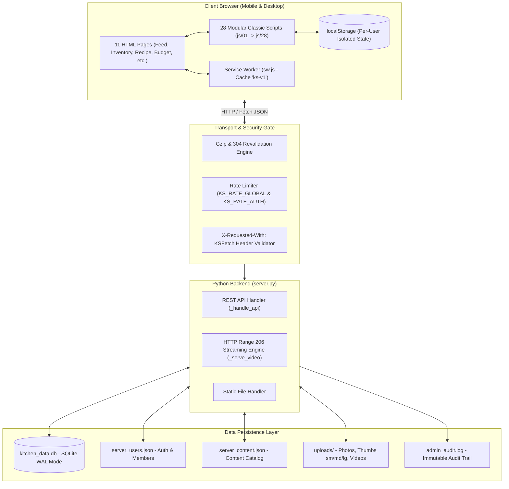
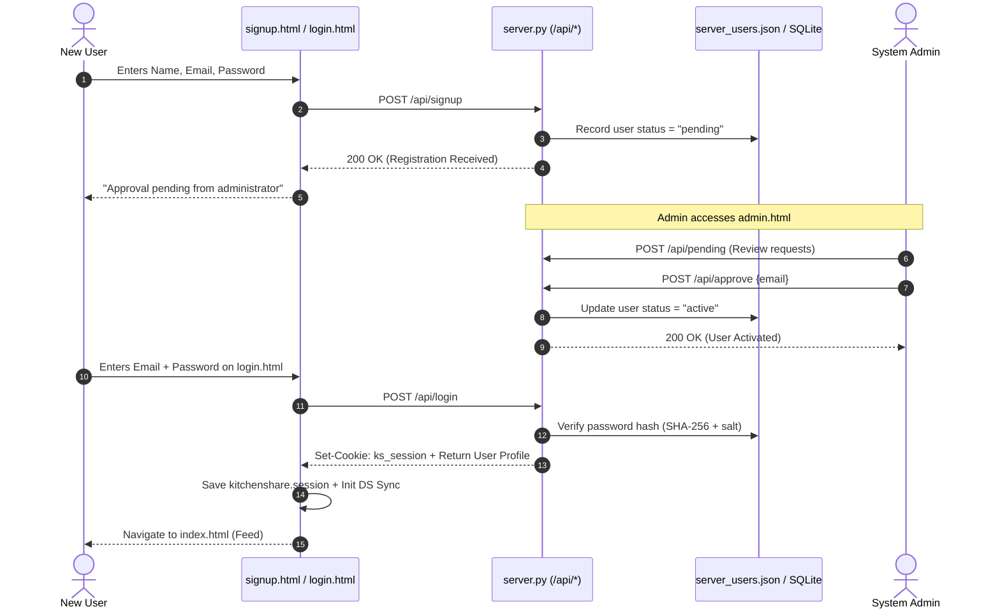
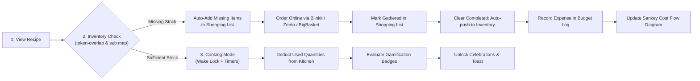
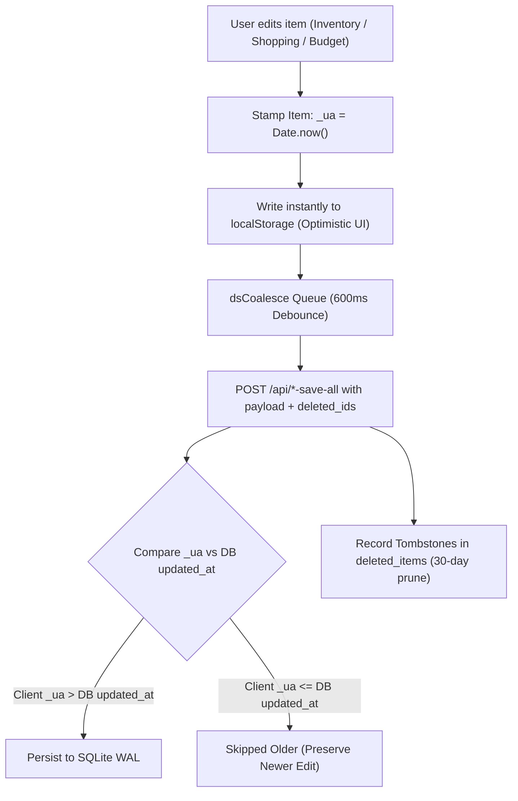

# KitchenShare — Smart Kitchen Hub (Prototype)

Single source of truth for the KitchenShare prototype. Read this before editing anything; update it for every change (see [Update convention](#update-convention)).

---

## 1. Overview & System Narrative

- **What:** KitchenShare is a **modern, multi-page web application** for household smart-kitchen management and community cooking. Users manage fresh inventory (with expiry alerts & FIFO sorting), compute nutrient profiles against a per-100g database, cross-match inventory to recipes (pantry-to-plate with smart substitutions), follow friends, join cooking groups, scale portions dynamically, trigger in-kitchen cooking step-timers with wake-lock, track food spending via an interactive Sankey budget diagram, export carts to quick-commerce providers (Blinkit, Swiggy Instamart, BigBasket, Zepto), and unlock gamified culinary badges.
- **Where:** `C:\Users\olduser\Desktop\Kitchen\stitch_kitchenshare_smart_kitchen_hub`
- **Architecture Philosophy:**
  1. **Hybrid Offline-First & Server-Authoritative**: Runs 100% offline via browser `localStorage` + Service Worker, but seamlessly syncs in real-time to a lightweight Python stdlib backend (`server.py`) backed by SQLite WAL (`kitchen_data.db`) and JSON registries.
  2. **Zero-Build Vanilla Multi-Page Application (MPA)**: 11 clean HTML pages. No Webpack, Vite, or npm bundlers required. Client logic is modularized across **28 classic JavaScript scripts** (`js/01_ui_shell.js` → `js/28_groups.js`) loaded sequentially.
  3. **Modern Tactile Minimalism**: Warm Terrazzo (`#675c53`), Sage Green (`#425842`), and Cream (`#54534e`) organic palette (Material 3 tokens) compiled into a high-performance static `tailwind.css` (~53 KB) with Google Fonts and Material Symbols.

---

## 2. High-Level Architecture & Workflow Graph ("Graphify")

### 2.1 Complete Application Topology

---

### 2.2 Core Application Workflows

#### A. User Authentication & Admin Approval Flow

#### B. The Cook-to-Pantry-to-Budget Lifecycle

#### C. Cross-Device Synchronization & Conflict Resolution (LWW)

---

## 3. Project File Directory

| Path | Category | Role |
|---|---|---|
| `index.html` | UI Page | Feed: catalogs, user recipes, community posts, "For You" ranking, diet filters. |
| `recipe-details.html` | UI Page | Hero slideshow, ingredient status, portion scaler, step timers, Wake Lock, comments, likes. |
| `my-kitchen-inventory.html` | UI Page | Fridge/Pantry/Spices stock, expiry chips, FIFO sorting, low-stock warnings, Pantry-to-Plate. |
| `shopping-list.html` | UI Page | Checkbox list, grouped by category, inventory auto-fill, Quick Commerce cart export. |
| `budget-dashboard.html` | UI Page | Visual Sankey cost-flow diagram, Indian FY switcher, category charts, expense transactions. |
| `people.html` | UI Page | User discovery, follow/unfollow toggle, cooking group creation and membership. |
| `login.html` | UI Page | User authentication, quick demo tap credentials, password recovery link. |
| `signup.html` | UI Page | User onboarding form triggering admin approval pipeline. |
| `admin.html` | UI Page | Admin dashboard: approve signups, member management, recipe/post moderation, audit log. |
| `user-profile.html` | UI Page | Dynamic stats (cooked, saved, streak), 15-badge grid, posts/recipes grids, GDPR export/delete. |
| `profile-share-sheet.html` | UI Page | Responsive sheet to share profile via WhatsApp, Instagram, or direct link. |
| `leaderboard.html` | UI Page | Ranked community leaderboards by recipes posted, followers gained, and active streaks. |
| `server.py` | Backend | Stdlib Python HTTP server with SQLite backend, REST routing, video streaming, auth, rate limiting. |
| `kitchen_data.db` | Database | SQLite WAL database holding 13 operational tables. |
| `server_users.json` | Registry | Active and pending user accounts, password hashes, and profiles. |
| `server_content.json` | Registry | Seeded community content and catalog entries. |
| `uploads/` | Storage | Raw user photos, thumbnail variations (`thumbs/sm`, `md`, `lg`), and videos (`videos/`). |
| `admin_audit.log` | Security | Append-only text log of administrative actions (suspensions, approvals, deletions). |
| `js/*.js` (28 files) | Client Logic | Modularized front-end controllers (01 through 28) loaded sequentially. |
| `i18n.js` | Localization | Multi-language engine for English (`en`), Tamil (`ta`), and Kannada (`kn`). |
| `nutrients.js` | Nutrition | Static nutritional lookup database per 100g with computational engine. |
| `styles.css` | Styling | Shared styling overrides, safe-areas, ambient shadows, animations. |
| `tailwind.css` | Styling | Precompiled, purge-optimized Tailwind CSS (~53 KB static). |
| `manifest.webmanifest`| PWA | Progressive Web App manifest with home screen icons and launch configs. |
| `sw.js` | PWA | Service Worker engine handling static asset precaching and network-first API requests. |

---

## 4. The 28 Client JavaScript Modules (`js/`)

Every page loads all 28 modules in filename order. There is no build step or bundler: declarations are top-level globals shared across files.

```mermaid
graph TD
    M01["01_ui_shell.js<br/>Shell & Navigation"] --> M02["02_store_users.js<br/>LocalStorage & Users Schema"]
    M02 --> M03["03_api_social.js<br/>Fetch Wrapper & Media APIs"]
    M03 --> M04["04_ds_coalesce.js<br/>DataStore & Coalesced Push"]
    M04 --> M05["05_sync_badge_seed.js<br/>Sync UI & Demo Content"]
    M05 --> M06["06_auth_session.js<br/>Session & Current User"]
    M06 --> M07["07_notifications_follows.js<br/>Follow Engine & Alerts"]
    M07 --> M08["08_achievements.js<br/>15 Badges & Streak Engine"]
    M08 --> M09["09_celebration_admin.js<br/>Celebration Modal & Admin Hooks"]
    M09 --> M10["10_comments_content.js<br/>Comments & Shared Ingredients"]
    M10 --> M11["11_user_data_time.js<br/>Data Helpers & Sanitization"]
    M11 --> M12["12_inventory_media.js<br/>Units, Avatars & Media Helpers"]
    M12 --> M13["13_profile_bookmarks_stats.js<br/>Stats Engine & Bookmarks"]
    M13 --> M14["14_my_recipes_sync.js<br/>User Recipes & Server Sync"]
    M14 --> M15["15_catalog_cook_shopping.js<br/>Master Catalog & Cook Action"]
    M15 --> M16["16_recipe_editor_feed.js<br/>Recipe Sheet & Photo Drag-Drop"]
    M16 --> M17["17_inventory_page.js<br/>My Kitchen Inventory Page"]
    M17 --> M18["18_recipe_details.js<br/>Recipe Details & Slideshow"]
    M18 --> M19["19_feed_page.js<br/>Feed, For-You Ranking & Search"]
    M19 --> M20["20_shopping_page.js<br/>Shopping List & Quick Commerce"]
    M20 --> M21["21_admin_people_board.js<br/>Admin Panel & Leaderboard"]
    M21 --> M22["22_profile_privacy_boot.js<br/>Profile, GDPR & Sync Boot Tail"]
    M22 --> M23["23_pantry_match.js<br/>Pantry-to-Plate & Substitutions"]
    M23 --> M24["24_diet_safety.js<br/>Diet Chips & Allergen Warnings"]
    M24 --> M25["25_cook_mode.js<br/>Scaling, Timers & Wake Lock"]
    M25 --> M26["26_pwa_offline.js<br/>PWA Service Worker & Network Toast"]
    M26 --> M27["27_budget_dashboard.js<br/>Budget Sankey Diagram & Spends"]
    M27 --> M28["28_groups.js<br/>Community Groups & Invitations"]
```

### Module Breakdown & Responsibilities

1. **`01_ui_shell.js`**: Injects `#ks-drawer`, `#ks-notif`, `#ks-toast`. Handles navigation transitions, toast alerts (`ksToast`), and global modal dismissing.
2. **`02_store_users.js`**: Defines `DB_KEYS`, `lsGet`/`lsSet` helpers, initial seed users (`sugu`, `swetha`, `viji`, `saravana`), and password migration handlers.
3. **`03_api_social.js`**: Handles network fetch communication with `X-Requested-With: KSFetch` headers, multipart image/video uploads, and social API wrappers.
4. **`04_ds_coalesce.js`**: The client DataStore (`DS`). Manages 600ms coalesced pushes to backend and local tombstone queues (`dsQueueDelete`).
5. **`05_sync_badge_seed.js`**: Renders the green/amber sync indicator badge in the topbar and manages demo content initializations.
6. **`06_auth_session.js`**: Controls user session state (`kitchenshare.session`), account switching (`switchUser`), and local login/logout routines.
7. **`07_notifications_follows.js`**: Follower graph management (`toggleFollow`, `followerCount`) and notification polling (30s interval).
8. **`08_achievements.js`**: Evaluates criteria for 15 achievements (cooking frequency, streaks, followers, recipes posted).
9. **`09_celebration_admin.js`**: Renders full-screen celebration modal with confetti/sparkles upon badge unlock; houses admin action handlers.
10. **`10_comments_content.js`**: CRUD operations for recipe and post comments, plus the shared ingredient autocomplete registry.
11. **`11_user_data_time.js`**: User data getters/setters (`userKey`), date/time formatting, and XSS sanitization (`esc`).
12. **`12_inventory_media.js`**: Measurement unit conversion (metric base units), photo rotation, avatar rendering, and video URL detection.
13. **`13_profile_bookmarks_stats.js`**: Aggregates profile statistics (recipes cooked, kg saved, day streaks) and bookmark array operations.
14. **`14_my_recipes_sync.js`**: Manages personal user recipes, sync queues (`syncPull`, `syncPushAll`), and post state.
15. **`15_catalog_cook_shopping.js`**: Built-in master recipe catalog (`RECIPES`), inventory deduction logic (`cook()`), and shopping bridge.
16. **`16_recipe_editor_feed.js`**: Recipe creator/editor bottom sheet, drag-and-drop media uploader, and video file validator (60s limit).
17. **`17_inventory_page.js`**: Controller for `my-kitchen-inventory.html`: item CRUD, stock counts, category tabs, and expiry chip renderers.
18. **`18_recipe_details.js`**: Controller for `recipe-details.html`: hero image slideshow, interactive checklist, plan rows, and cook sheets.
19. **`19_feed_page.js`**: Controller for `index.html`: personalized "For You" ranking, search debounce (150ms), like toggles, and post renders.
20. **`20_shopping_page.js`**: Controller for `shopping-list.html`: item grouping, clear-completed action, and Order Online cart deep-link generation.
21. **`21_admin_people_board.js`**: Controller for `admin.html`, `people.html`, and `leaderboard.html` views.
22. **`22_profile_privacy_boot.js`**: Profile page controller, GDPR JSON data export, account deletion modal, and universal post-boot server sync trigger.
23. **`23_pantry_match.js`**: "Pantry-to-Plate" recommendation engine. Calculates percentage ingredient overlap against inventory and suggests substitutions (`KS_SUBS`).
24. **`24_diet_safety.js`**: Dietary compliance tags (Vegan, Halal, Jain, Gluten-Free) and automated cross-contamination allergen warning scans.
25. **`25_cook_mode.js`**: In-kitchen cooking experience: live portion scaler (×0.5 to ×3.0), step duration parser to timer chips, audio chime (`beepTimesUp`), and Screen Wake Lock API.
26. **`26_pwa_offline.js`**: Registers `sw.js` Service Worker, listens to `online`/`offline` window events, and presents connection status toasts.
27. **`27_budget_dashboard.js`**: Controller for `budget-dashboard.html`: custom SVG Sankey diagram generator, Indian financial year partitioning, and real-time polling.
28. **`28_groups.js`**: Community cooking groups engine: create groups, invite mutual followers, browse shared member lists.

---

## 5. Backend Architecture & API Specification (`server.py`)

The server runs on Python standard library (`http.server`, `sqlite3`, `hashlib`, `json`). No third-party pip dependencies are strictly required (Pillow is used optionally for thumbnail resizing; ffmpeg optionally for video thumbnail extraction).

### 5.1 SQLite WAL Database Schema (`kitchen_data.db`)
- `kitchen_items`: `(id, owner_id, name, qty, unit, min, cat, expires_on, price, updated_at, is_deleted)`
- `shopping_items`: `(id, owner_id, name, qty, unit, done, group_name, cat, price, updated_at, is_deleted)`
- `recipes`: `(id, owner_id, title, tag, time_min, kcal, servings, ingredients, steps, photos, video, diet, updated_at, is_deleted)`
- `posts`: `(id, owner_id, text, by_name, photos, video, created_at, updated_at, is_deleted)`
- `comments`: `(id, recipe_id, post_id, user_id, user_name, text, created_at)`
- `profiles`: `(user_id, name, tagline, bio, photo, updated_at)`
- `likes`: `(item_id, user_id, created_at)`
- `follows`: `(follower_id, following_id, created_at)`
- `notifications`: `(id, user_id, actor_id, type, item_id, title, read, created_at)`
- `achievements`: `(user_id, badge_id, unlocked_at)`
- `spending`: `(id, owner_id, amount, category, item, qty, unit, date, ts, is_deleted, created_at, updated_at)`
- `groups`: `(id, name, owner_id, created_at)` + `group_members: (group_id, user_id, role, status)`
- `deleted_items`: `(kind, item_id, deleted_at)` (Tombstones for durable multi-device synchronization)

### 5.2 API Endpoint Registry

| Route | Method | Payload / Description |
|---|---|---|
| `/api/signup` | POST | `{name, email, password}` → Registers user in `pending` state |
| `/api/login` | POST | `{email, password}` → Returns user record + sets `ks_session` |
| `/api/logout` | POST | Clears session cookie |
| `/api/me` | GET | Validates cookie session; returns logged-in user |
| `/api/pending` | GET | Admin: returns pending registration requests |
| `/api/approve` | POST | Admin: approves pending user to `active` |
| `/api/decline` | POST | Admin: declines and deletes pending user |
| `/api/upload-image` | POST | Multipart form: validates JPEG/PNG/WebP, saves to `uploads/` + creates thumbnails |
| `/api/upload-video` | POST | Multipart form: saves MP4/WebM (<50MB, <60s) to `uploads/videos/` |
| `/uploads/videos/*` | GET | **HTTP 206 Partial Content Range streaming** (enables video scrubbing) |
| `/api/kitchen-list` | POST | Returns current user's inventory items |
| `/api/kitchen-save-all` | POST | Bulk LWW upsert with `_ua` timestamps and tombstone sync |
| `/api/shop-list` | POST | Returns current user's shopping list |
| `/api/shop-save-all` | POST | Bulk LWW upsert with `_ua` timestamps and tombstone sync |
| `/api/budget-list` | POST | Returns user's spending transaction history |
| `/api/budget-save-all` | POST | Bulk LWW upsert of spending records |
| `/api/activity-feed` | POST | Returns timeline posts from self + followed accounts |
| `/api/like` / `/api/unlike` | POST | Toggles post/comment like and triggers notification |
| `/api/follow` / `/api/unfollow`| POST | Manages social follow relationships |
| `/api/achievements-evaluate` | POST | Computes server-authoritative badge unlocks |
| `/api/leaderboard` | POST | Returns global rankings (recipes, followers, streaks) |
| `/api/group-create` / `invite`| POST | Creates cooking groups and manages invitations |
| `/api/export-my-data` | POST | GDPR compliance: exports all user records as JSON |
| `/api/delete-my-account` | POST | GDPR compliance: permanently cascades deletion of all user data |

---

## 6. End-to-End User Experience & Interaction Scenarios

### Scenario 1: The Smart Grocery-to-Pantry Flow
1. User plans dinner and opens `shopping-list.html`.
2. They click **Add Item**; the bottom sheet opens with datalist autocomplete connected to `nutrients.js` and known ingredients.
3. User enters "Tomatoes", 500g, category "Fridge", price ₹40.
4. Instead of shopping manually, user taps **Order Online**: a sheet displays deep-links directly opening Blinkit, Zepto, or Instamart prefilled with their grocery query.
5. Once groceries arrive, user toggles the checkbox next to Tomatoes and taps **Clear Completed**.
6. The app automatically:
   - Removes Tomatoes from the shopping list.
   - Pushes 500g Tomatoes into `my-kitchen-inventory.html` with category "Fridge".
   - Records a ₹40 expense under "Fridge" in `kitchenshare.u.<uid>.spending_log`.
   - Re-renders the **Budget Dashboard Sankey flow** showing ₹40 moving from "Fridge" to "In Stock".

### Scenario 2: The In-Kitchen Cooking Experience
1. User opens `recipe-details.html?recipe=rustic-basil-pomodoro`.
2. The page evaluates inventory:
   - Basil: In stock (green check).
   - Pasta: Low stock (amber indicator).
   - Heavy cream: Missing (red indicator).
3. The user taps **Cook Mode**:
   - The screen acquires a **Screen Wake Lock** so the phone does not turn off while cooking with messy hands.
   - User adjusts the portion scaler from 2 servings to 4 servings: all ingredient weights live-recalculate by 2×.
   - Step 3 reads *"Simmer sauce for 15 minutes"*; the app parses "15 minutes" into an interactive chip.
   - User taps the chip: a 15-minute countdown starts with a visual progress ring. When done, a WebAudio chime sounds and the device vibrates.
4. User taps **Cook Now**:
   - Inventory quantities are automatically deducted from the kitchen.
   - User's cook streak increments.
   - If this is their 5th recipe, the **Spice Master** achievement unlocks with a gold celebration modal and confetti.

### Scenario 3: Community & Social Sharing
1. User snaps a picture or records a 30-second video of their finished dish.
2. They open the **Recipe Creator** sheet, attach dietary chips (Vegetarian, Gluten-Free), and upload media.
3. The backend stores the media, produces optimized thumbnails, and indexes the recipe.
4. Followers see the new recipe appear in their personalized Feed under the "Community Recipes" section with interactive like and comment buttons.

---

## 7. Verification & Quality Assurance Suite

KitchenShare includes automated test suites covering all workflows:
- **`seed.py`**: Resets the SQLite database and JSON registries to a pristine test state with 4 accounts.
- **`load_test.py`**: Concurrency test simulating 50–100 simultaneous workers executing reads, auth, and writes.
- **`lan_test.py`**: Validates local area network and mobile device reachability.
- **`QA_CHECKLIST.md`**: Matrix testing across viewport sizes (320px, 768px, 1280px) and user permissions.
